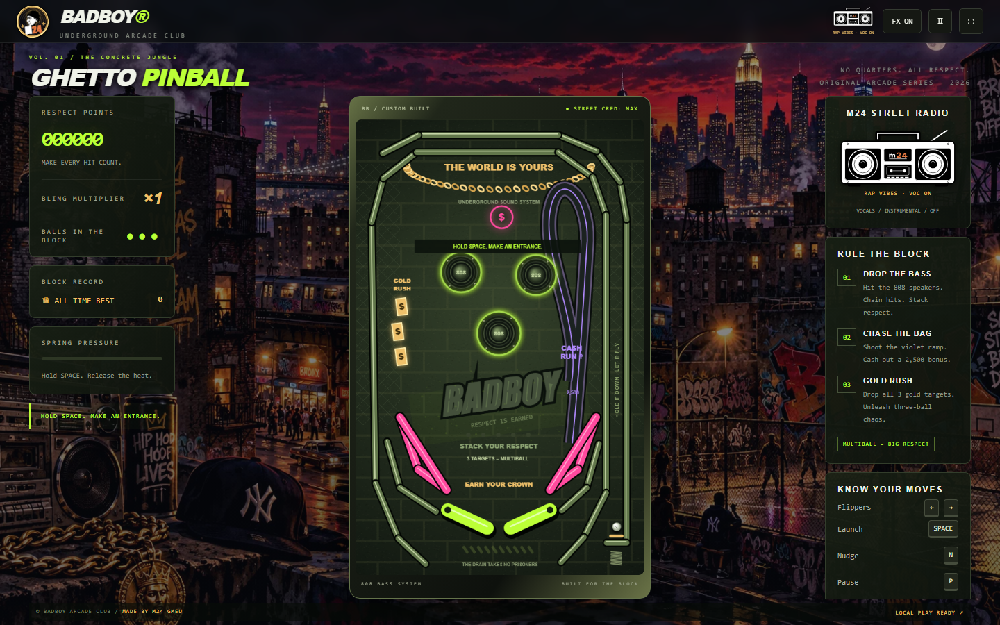

# BADBOY — Ghetto Pinball

**M24 GMEU · Bronx Style · No quarters. All respect.**

Ein Pinball-Arcade-Spiel für Desktop, Tablet und Handy: eigene 2D-Physik, Multiball, neonfarbene Bumper und ein animierter M24-Ghettoblaster mit Rap-Soundtrack. Das Spielfeld passt sich dem sichtbaren Browserfenster und dem Vollbild an – im Hochformat und im Querformat.



## Starten

`index.html` direkt im Browser öffnen. Spiel, Bronx-Hintergrund und M24-Kopflogo sind in der HTML-Datei enthalten. Die beiden Musikdateien unter `assets/` müssen für den Soundtrack danebenliegen. Ein Build ist nicht erforderlich.

Für PWA, Offline-Cache und lokale Entwicklung mit installiertem Node.js:

```sh
git clone https://github.com/meuse24/flipper.git
cd flipper
npm start
```

Anschließend **[http://127.0.0.1:8090](http://127.0.0.1:8090)** öffnen. Für diesen Start sind keine npm-Abhängigkeiten nötig. Ein anderer Port lässt sich über `PINBALL_PORT` einstellen.

## Steuerung

| Aktion | Tastatur | Handy / Tablet |
| --- | --- | --- |
| Linker / rechter Flipper | ← / → oder A / D | Linke / rechte Spielfeldhälfte oder Flipper-Tasten |
| Kugel starten | Leertaste oder ↓ halten, dann loslassen | **HOLD TO LAUNCH** halten und loslassen |
| Tisch anstoßen | N | — |
| Pause / fortsetzen | P | Pause-Taste oben |
| Vollbild umschalten | F | Vollbild-Taste oben |
| Start / Neustart | Enter oder Startknopf | Startknopf |
| Musik umschalten | Ghettoblaster anklicken | Ghettoblaster antippen |

Der Ghettoblaster schaltet zwischen **Gesang → Instrumental → Aus**. Seine Lautsprecher pulsieren anhand des tatsächlichen Abspielzeitpunkts. **FX ON/OFF** steuert die synthetischen Spieleffekte unabhängig von der Musik. Audio startet nach einer Benutzeraktion. Android kann Vollbild mit der Zurück-Geste bzw. Zurück-Taste beenden; am Desktop funktioniert auch Escape.

## Spielregeln

- Drei Kugeln pro Partie. Die Startphase schützt acht Sekunden lang vor einem verlorenen Ball.
- Die drei 808-Speaker bringen Respect Points. Schnelle Treffer bilden Combos.
- Alle drei goldenen Ziele abräumen: drei Kugeln gleichzeitig und ein höherer Bling-Multiplikator.
- Aufwärts in die violette **Cash Run**-Rampe schießen: 2.500 Punkte mal Multiplikator.
- Slingshots und Kicker bringen zusätzliche Punkte. Zu viele schnelle Nudges sperren die Flipper für vier Sekunden: **TILT**.
- Der Highscore bleibt im lokalen Browserspeicher erhalten, sofern dieser verfügbar ist.

## Fenster, Vollbild und Ausrichtung

Die Größenberechnung berücksichtigt den sichtbaren Viewport, mobile Browserleisten, Displayausschnitte und Vollbildwechsel. Die Tischproportionen und die Physik bleiben beim Drehen erhalten. Im Hochformat stehen Score und Touch-Tasten oberhalb bzw. unterhalb des Tisches; auf niedrigen Querformat-Displays liegen die Flipper-Tasten seitlich. Start- und Pausenmenüs passen sich ebenfalls an die verfügbare Höhe an.

## Als App installieren / offline spielen

Das Spiel einmal online über **HTTPS oder localhost** laden. Im Startmenü **INSTALL APP** wählen. Unterstützte Browser zeigen ihren Installationsdialog; sonst erscheint eine passende Browser-Anleitung. Auf iPhone/iPad wird die Installation über Safari erklärt.

Diese Dateien gemeinsam bereitstellen:

```text
index.html
pwa.js
sw.js
manifest.webmanifest
assets/
  icon-180.png
  icon-192.png
  icon-512.png
  lucky-seven-song.mp3
  lucky-seven-theme.mp3
```

Der versionierte Cache enthält auch beide Musikdateien und unterstützt Audio-Bytebereiche für die Offline-Wiedergabe. Updates werden im Start- oder Game-over-Menü angeboten und erst nach Bestätigung aktiviert. Laufende und pausierte Partien werden nicht automatisch neu geladen. Für eine Veröffentlichung die Cacheversion in `sw.js` erhöhen und die neuen Dateien vollständig hochladen, den Worker zuletzt.

Beim direkten Öffnen über `file://` funktioniert das Spiel einschließlich lokaler Musikdateien; PWA-Installation und Service Worker benötigen einen Webserver. Alle öffentlichen Laufzeitdateien sind statisch und können beispielsweise auf GitHub Pages oder einem eigenen HTTPS-Webspace liegen.

## Technik und Tests

Vanilla JavaScript, Canvas und Web Audio ohne Framework oder Produktionsabhängigkeiten. Die eigene Physik läuft mit 240 festen Teilschritten pro Sekunde und verarbeitet bewegte Flipper, Reibung, Spin und Kugelkollisionen. Das Tisch-Artwork entsteht prozedural; Bronx-Hintergrund, M24-Silhouette, Musik und PWA-Gestaltung stammen aus dem M24-Slotmachine-Projekt.

Automatisierte Browserprüfungen mit laufendem lokalen Server:

```sh
npm install
npx playwright install chromium
npm test
npm run test:responsive
npm run test:audio
```

Die Prüfungen decken unter anderem Launcher, Bumper, Multiball, Rampe, Drain, Neustart, Tilt, Touch-Layout, neun Viewport-Größen sowie Offline-Wiedergabe beider Tracks ab. Testbilder und Zustände landen unter `output/` und werden nicht eingecheckt.

Zusätzlich auf einem per USB angeschlossenen **Samsung Galaxy S10e (SM-G970F)** geprüft: echtes Hoch-/Querformat, Browserfenster, natives Vollbild, Feder-Aufzug, gleichzeitige Touch-Flipper und Musikwechsel. Fenster-Viewports unter anderem 360 × 617 / 673 × 280, Vollbild 360 × 760 / 760 × 360 CSS-Pixel. Die automatische Bildschirmdrehung wurde nach den Tests wiederhergestellt.

## Medien und Herkunft

**meuse24 / M24 GMEU, 2026.** Die ursprünglichen Medienbedingungen bleiben in [MEDIA-LICENSE.md](MEDIA-LICENSE.md) erhalten. Der übernommene PWA-Code stammt aus Lucky Seven; dessen MIT-Hinweis steht in [SLOT-PWA-LICENSE.txt](SLOT-PWA-LICENSE.txt). Die Medienlizenz ist keine allgemeine Freigabe als eigenständiges Asset-Paket.
